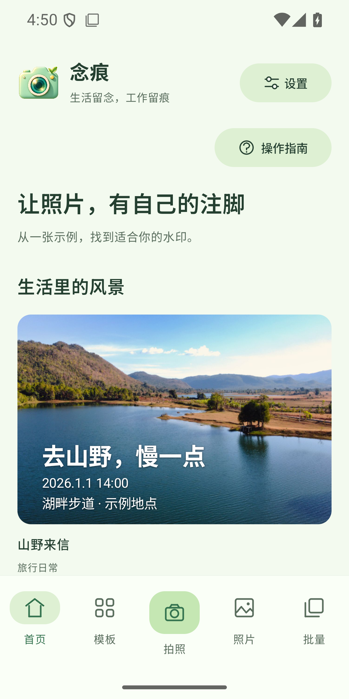
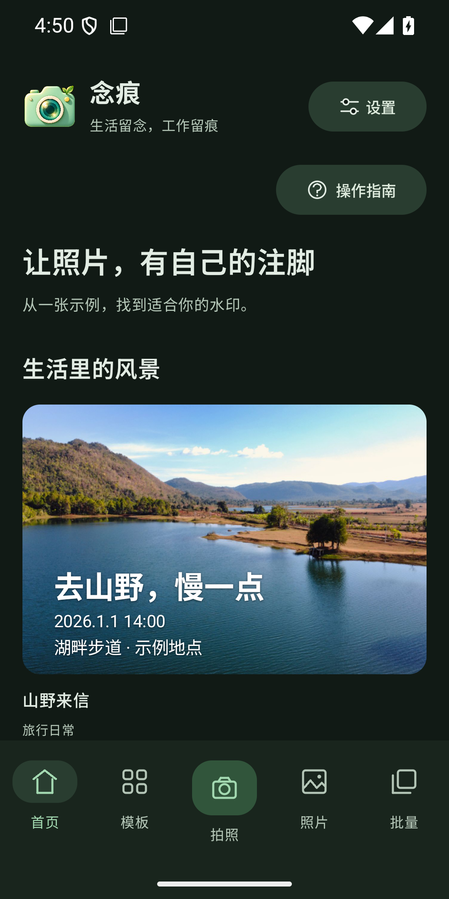

# 念痕水印相机

**生活留念，工作留痕。**

一款兼顾生活记录与工作记录的 Android 水印相机。拍照、相册选图、批量处理，按自己的习惯组合文字、边框和背景。

当前版本：**0.4.16-alpha** · Android 8.0 及以上 · 内测版。

## 下载

| 平台 | 安装包 | 大小 |
| --- | --- | --- |
| Android 8.0+ | [下载 nianhen-0.4.16-alpha.apk](https://github.com/lyq-05/nianhen/releases/download/v0.4.16-alpha/nianhen-0.4.16-alpha.apk) | 17.96 MiB |

[查看发布说明与附件](https://github.com/lyq-05/nianhen/releases/tag/v0.4.16-alpha) · [版本历史](CHANGELOG.md)

下载后在手机打开 APK，按系统提示允许当前来源安装。已有内测版可覆盖安装，请勿先卸载；卸载会删除本机模板，建议先导出模板备份。

## 界面

| 浅色主题 | 夜间主题 |
| :---: | :---: |
|  |  |

截图展示内置示例与 0.4.13 起使用的首页主题，示例时间和地点不代表照片真实拍摄信息。

## 功能

- **拍照加水印**：连续拍摄、前后摄像头切换、位置获取，按需保存原图。
- **自由组合**：24 套生活与工作场景模板，多块水印拖动，文字、边框、颜色、透明度及 Logo 图片可调整。
- **个人模板**：保存自己的组合，支持模板文件导入、导出和分享。
- **照片处理**：相册单张选图，最多 30 张批量处理，可逐张编辑或统一补填信息。
- **查看与分享**：应用内查看成片，直接调用系统分享面板选择微信等应用；拍后编辑导出的新成片会回到“本次拍摄”。
- **使用辅助**：图文操作指南、界面字体调节、浅色／夜间／跟随系统主题。

## 常见问题

**照片会上传吗？** 图片在本机处理；系统地址解析可能使用网络。主动分享时，由你选择的接收应用处理照片。

**不保存原图，还能改水印吗？** 新版在本次拍摄期间保留编辑底稿，可修改水印；相册仍只保存水印成片。旧版已删除底稿的照片不能恢复旧图层。

**重启后能接着编辑吗？** 本次拍摄记录、未保存编辑和批量队列尚不支持杀进程恢复。长期使用的样式请保存模板，成片请及时导出。

**有 AI 修复或收费功能吗？** 当前内测版暂无 AI 图片修复，无需注册账号，暂无收费。

## 反馈与说明

可通过 [Issues](https://github.com/lyq-05/nianhen/issues) 反馈手机型号、安卓版本、复现步骤和预期结果；请先将截图中的个人或工作敏感信息去除。

本仓库仅提供应用介绍、截图、版本说明和安装包，**暂不公开源码**。APK 使用现有内测开发签名，尚非应用市场正式版。输出为 JPEG，超大照片可能受设备内存限制。
